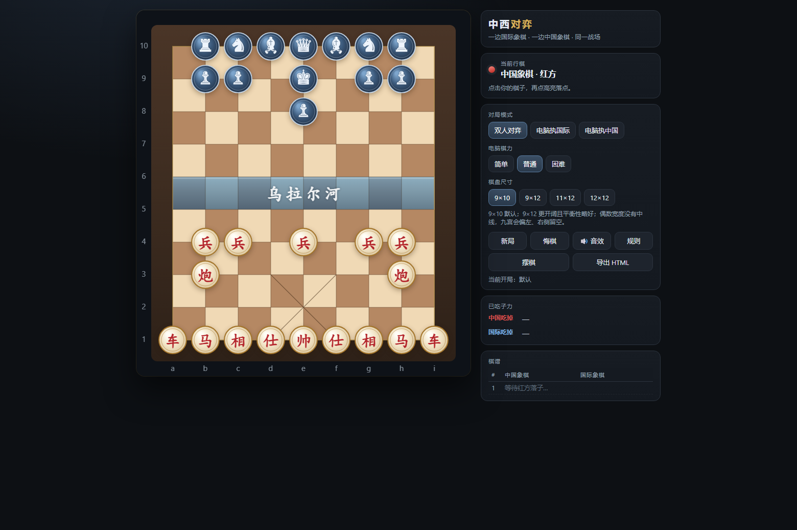
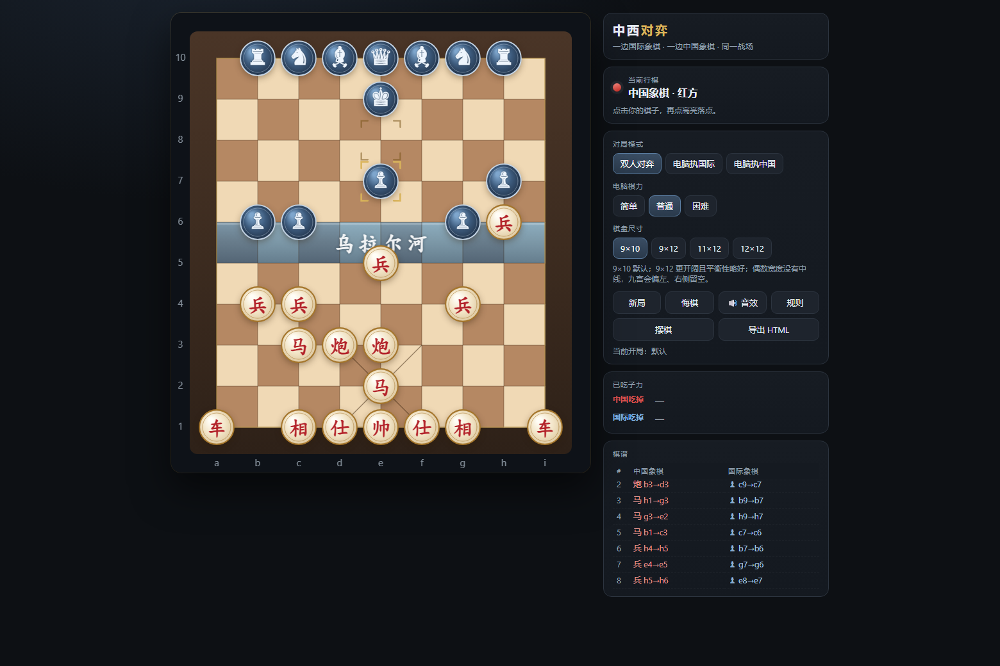
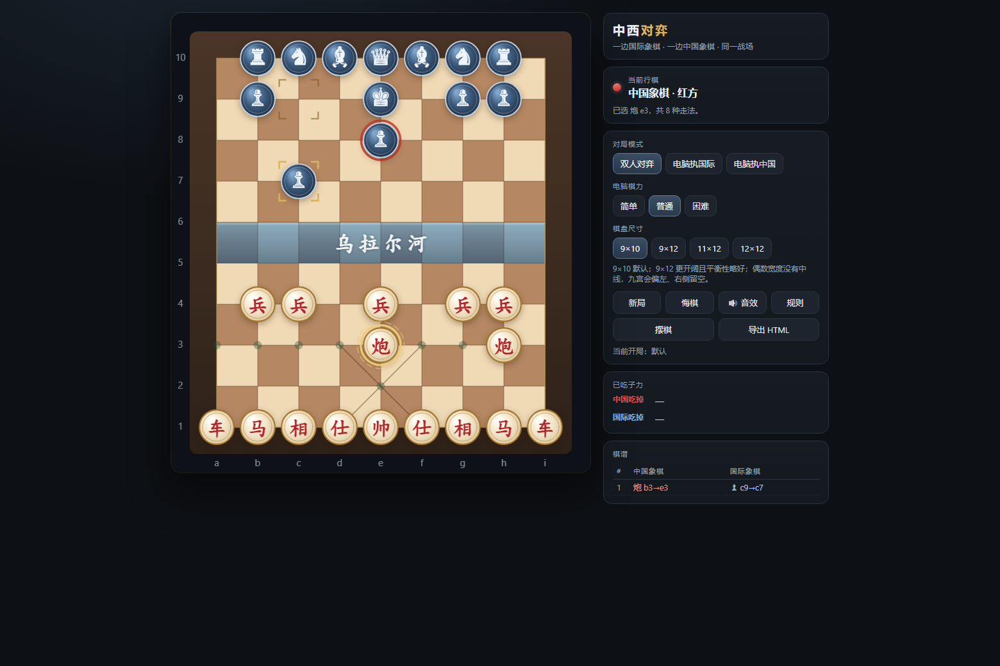
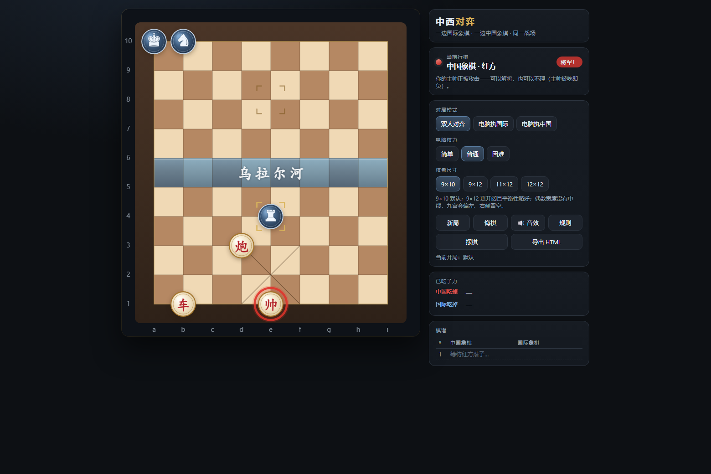
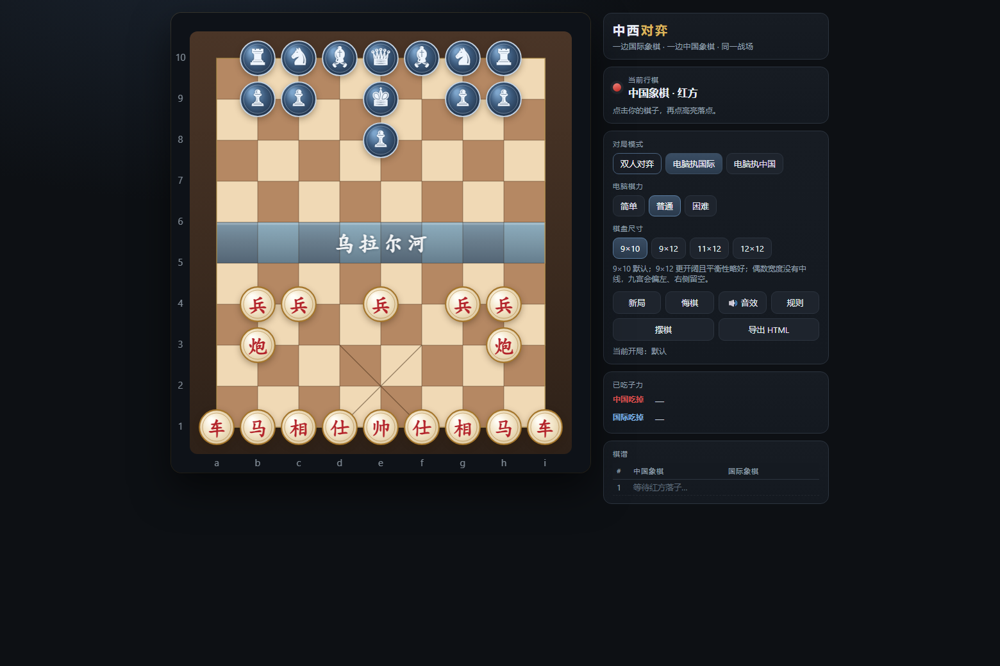
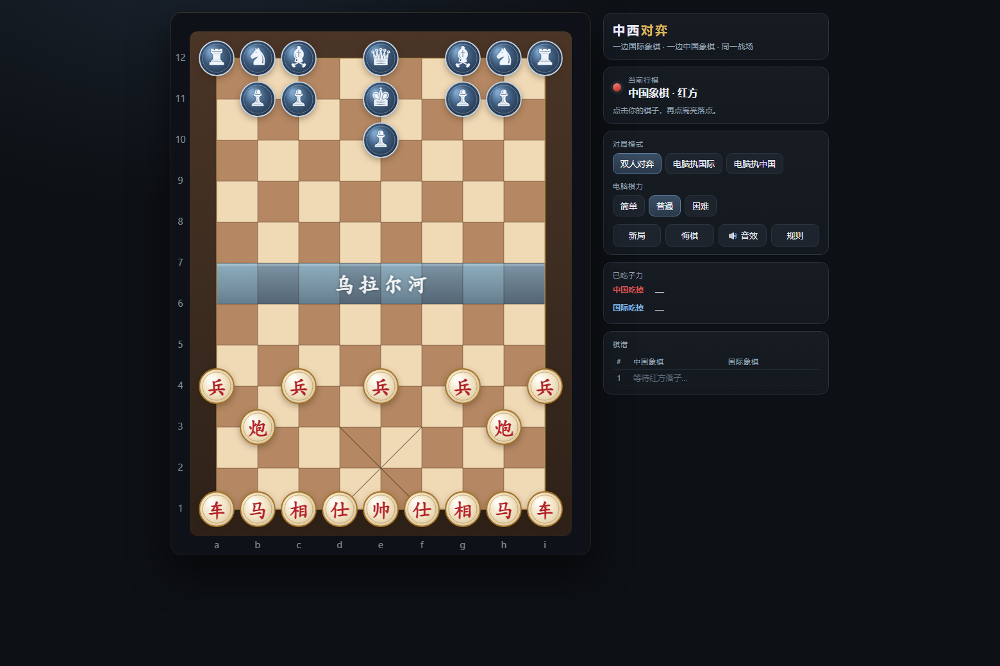
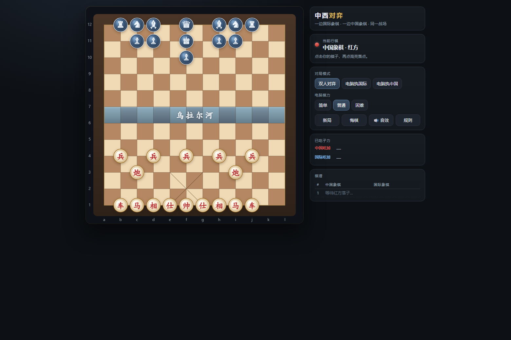

# 中西对弈 · 国际象棋 vs 中国象棋

一张 9×10 的交叉点棋盘，**下方是中国象棋（红方），上方是国际象棋（钢蓝方）**。
棋盘采用国际象棋的深浅格美术风格，中间那条河叫**乌拉尔河**。
两军各子严格按自己棋种的走法行动，**吃掉对方的「帅 / 王」即获胜**。

打开 `index.html` 即可玩（需要同目录的 `engine.js`）。
**想直接下载单个文件玩**：用 `chess-vs-xiangqi.html` —— 它把引擎内联进去了，无任何外部依赖，
双击就能离线运行，也可以拷到手机/别的电脑上。



## 开局布局

中国象棋方与国际象棋方都按下面的阵型摆（国际象棋七子缩进成一排紧挨着）：

```
 10  ·  车 马 象 后 象 马 车  ·      ← 后排七子缩进到 b10..h10，紧挨着
  9  ·  ·  兵 兵  王  兵 兵  ·  ·    ← 兵墙压在王与双象前，b9/h9 留空给双车
  8  ·  ·  ·  ·  兵  ·  ·  ·  ·     ← e8 哨兵：挡住中炮沿 e 线的直接威胁
  7  ·  ·  ·  ·  ·  ·  ·  ·  ·
  6  ·  ·  ·  ·  ·  ·  ·  ·  ·
  5  ·  ·  ·  ·  ·  ·  ·  ·  ·
  4  ·  兵 兵  ·  兵  ·  兵 兵  ·    ← 红兵在 b4 / c4 / e4 / g4 / h4（两个边兵从 a4/i4 挪进来）
  3  ·  炮  ·  ·  ·  ·  ·  炮  ·    ← 双炮在 b3 / h3
  2  ·  ·  ·  ·  ·  ·  ·  ·  ·
  1  车 马 相 仕 帅 仕 相 马 车
     a  b  c  d  e  f  g  h  i
```

- **王在王后正前方**（后 e10、王 e9）；后排 `车 马 象 · 后 · 象 马 车` 左右对称且不能留缝；
- 蓝方 5 个兵：b9 / h9 压在双车前面，c9 / g9 在两侧，e8 是王前哨兵；
- 红方 `帅` 多一条**飞将**（同一列上一个子若正好是对方的王，可以直接飞过去吃）——**这个特权只有红方有**。

## 玩法


- **红方先手**。点击自己的棋子 → 高亮落点 → 点击落点落子。
- 上一步用金色角标标出；被将军时主帅会亮红色光晕，面板上出现「将军！」。
- 三种模式：双人对弈 / 电脑执国际 / 电脑执中国；电脑棋力三档（简单=2 层、普通=3 层、困难=4 层，alpha-beta 搜索 + 吃子静态搜索）。
- 棋盘尺寸四档（9×10 / 9×12 / 11×12 / 12×12），面板里点一下即可切换，九宫、河界与双方阵型会按新尺寸重排；
  也支持 `index.html?size=9x12` 这样的地址参数。
- 悔棋（双人模式退一手，人机模式退一整回合）、新局、音效开关、棋谱与已吃子力记录。
- 快捷键：`N` 新局、`U` 悔棋、`Esc` 取消选中。

### 摆棋：自己改初始局面，还能导出成文件

面板上的 **「摆棋」** 进入编辑器：

1. 点调色板里的棋子（红方 7 种 + 蓝方 6 种 + 橡皮），再点棋盘放置；**右键删除**；不选子时点两下可以搬子。
2. 编辑器会实时统计「红 N 子（帅 x）· 蓝 M 子（王 y）」，**必须有且只有一个帅、一个王**才能保存。
3. **保存为初始棋盘** → 存进浏览器 localStorage，之后每次「新局」都从这个局面开始，面板上会标「当前开局：自定义」。
4. **恢复默认开局** → 一键回到标准阵型。
5. **导出 HTML** → 把当前开局写进一份独立 HTML 并下载（`chess-vs-xiangqi-custom.html`），
   双击就能玩这一版，发给别人也不会丢。

## 两边各按各的规矩走

| | 中国象棋 · 红方（下方） | 国际象棋 · 钢蓝方（上方） |
|---|---|---|
| 帅 / 王 | 九宫内一步直行；**另有飞将** | 周围一格（没有飞将） |
| 仕 / 后 | 九宫内一步斜行 | 直线斜线任意格 |
| 相 / 象 | 走田字、塞象眼、**不过河** | 斜线任意格 |
| 马 | 走日字、**蹩马腿** | 走日字、**不蹩腿** |
| 车 | 直线任意格 | 直线任意格 |
| 炮 | 走同车，**吃子必须隔一个炮架** | — |
| 兵 | 只进不退，过河后可横走，走吃同法 | 直进一格，首步两格，**只斜吃**，到底线升后 |

不含王车易位与吃过路兵。

**斜着走的子不能跨河**（本版新规则）：后、象、以及王的那两步斜走，斜线一律停在岸边，
想过去必须单独走一格**直走**（象 e6→e5、王 e6→e5），过了河才能继续斜着打。
直线走法（车 / 后 / 兵）不受影响，马也不受影响（它本来就不算斜着滑行）。

## 两点需要知道的约定

1. **不做「不可送将 / 不可自我将军」的判定**。这是为了让两套规则能共存：把帅或王走进对方火力网是允许的，只是会被吃掉。界面会尽量提醒（将军标签 + 光晕 + 音效）。
2. **两边各有一条致命的直线**：红方「炮 b3→e3」（中炮）之后，只要 e 线没有遮挡就能隔着自己的 e4 兵直取黑王 e9——所以 e8 那个哨兵兵很重要，它一倒就要立刻补位。反过来，黑方的后与车沿直线冲下来时，只要有一子走到 d2 或 f2 就是**闷宫杀**（红帅两侧被自己的仕堵死，无路可走）；红方守这两个点的子力是 b1 的马与 f1 的仕，别随手调开。
3. **飞将**只给红方：红帅与蓝王同列且中间无子时，红帅可以一口吃掉蓝王。所以蓝方在 e 线上要时刻留子。

其余：连续 50 回合（100 步）无吃子判和；棋盘用国际象棋的深浅格配色，「乌拉尔河」只是分界线，不限制任何走法；九宫对角线只约束红方的帅与仕。

## 平衡性实测：谁更强？

用引擎自战实测（`dev-depth.cjs` / `dev-matchup.cjs` / `dev-matecheck.cjs`）。红 = 中国象棋方，蓝 = 国际象棋方。

### 调整前后对比（AI 深度2 自战，各 120 局）

| 布局 | 红胜 | 蓝胜 | 和 | 红方占决胜局 |
|---|---|---|---|---|
| 初版（8 兵、王在 e10、楚河汉界） | 0% | **89.2%** | 10.8% | 0% |
| 5 兵、王在 e9、哨兵 e8、对称后排 | 4.2% | **48.3%** | **47.5%** | 7.9% |
| 七子缩进 + 双车压兵 + 红兵 b4/h4 + 飞将 | 2.5% | 78.3% | 19.2% | 3.1% |
| 再加「斜着走的不能跨河」 | 9.2% | 75.8% | 15.0% | 10.8% |
| **兵墙堵后 + 双车放开（当前）** | **5.8%** | **75.8%** | 18.3% | 7.1% |

纯随机走子两版都接近五五开（现版红方占决胜局 51.7%），说明子力上没有一边倒。

### 这一版为什么反而更难（2.5%）

两处改动都会削弱红方，而且都正中它的命门：

1. **红兵从 a4/i4 挪到 b4/h4，把双炮的竖线堵死了**。炮在 b3/h3，正上方就是自己的 b4/h4 兵，
   既上不去也护不住这个兵——炮要吃子必须隔一个炮架，所以**炮永远无法在 b4 上反吃**。
   蓝后最顺的进法就是白吃这个兵（自战里反复出现，AI 拿它当免费子力）。
2. **蓝方七子缩进成一排、双车前面压着兵**：蓝方开局走法从 45 掉到 29，但它本来就不靠车的机动性赢——
   而缩进之后每个子都在互相保护，红方反而更难吃到便宜。

飞将对红方是加分项（AI 会优先用它吃王），但 e 线上有红兵 e4 + 蓝哨兵 e8 两层遮挡，实战里很少能兑现。

更深搜索下蓝方仍占优：**深度3 抽测 20 局：红 0% / 蓝 75% / 和 25%**，均 89 步
（吃子静态搜索让双方都更少犯错，强方优势被放大）。

### 可选的补偿（想扳平的话）

| 调整 | 效果 |
|---|---|
| 红炮挪到 a3/i3（兵墙外那一列，重新有竖线） | 深2 60 局：红 0% —— 不够 |
| 让 `仕` 在九宫内也能走一步直行（覆盖 d2/f2 闷宫点） | 未实测，是结构性的解法 |
| 去掉蓝方的后 | 历史上最有效（初版布局下红胜率 46.7%） |

**但更省事的办法是界面里的「摆棋」**：直接把自己的阵型摆一遍、保存，就是你的规则。

更深搜索下蓝方仍占优（深度3：蓝 90%，60 局；深度4：蓝 90%，10 局），
但均局步数从初版的 8 步拉长到 32~73 步，红方不再是「开局就被照本宣科地杀死」。

### 根因

不平衡来自**杀王难度的不对称**：

- 红帅在九宫里只有 3 个相邻格，开局两侧被自己的仕占住，**实际逃生格只有 1 个**。
  蓝方任意一子走到 d2/f2（(3,8)/(5,8)）即可**单子闷宫杀**——实测某一局红方 45 个合法着法里 **0 个能解将**。
  而蓝王有 6~8 个逃生格且在盘面中央活动，红方要靠马、炮（吃子还必须隔炮架）去追，基本追不上。
- 机动性：蓝方每回合平均 55 个合法着法上下，红方 33–42。
- 蓝兵可升后（+900 子力雪球），红兵无升变。
- 红的相/仕永远不能进攻，在「一个子就能杀王」的环境里防守价值被大幅稀释。

不过局面并非一开始就输：实测**红方第一手 46 种走法，走完后蓝方在 4 层内都没有强制杀**；
闷宫杀的前一手也仍有多数着法可以挡住。所以红方是「**必须连续精确防守**」，
而蓝方只需要一路顺畅地走过来。

### 想进一步扳平的话（AI 深度2，各 120 局，初版布局下实测）

| 调整 | 红胜 | 蓝胜 | 和 |
|---|---|---|---|
| 均势基准（初版） | 0% | 89.2% | 10.8% |
| 蓝少一象 | 0.8% | 92.5% | 6.7% |
| 蓝少一车 | 5.8% | 40.8% | 53.3% |
| 蓝少一后 | 46.7% | 20.0% | 33.3% |
| 红少一炮 | 0% | 74.2% | 25.8% |

更贴近 50/50 的候选：**去掉蓝方的后**，或**让红帅可以在九宫内斜走一步**
（后者能让单子闷宫杀失效：帅可以直接斜吃掉 f2 上无保护的后）。

## 棋盘尺寸实测：9×10 / 9×12 / 11×12 / 12×12

引擎已参数化（`E.configure(n, m)`：九宫随中央列走、河永远在正中、两军阵型按宽度自动重排），
所以可以直接对比不同尺寸。**页面用 `index.html?size=9x12` 就能换尺寸**，默认仍是 9×10。

开局走法数（红/蓝）随尺寸变化：9×10 → 46/45，9×12 → 50/49，11×12 → 54/55，12×12 → 56/57
（蓝方机动性优势随尺寸缓慢变大）。

**纯随机走子（各 2000 局）——看局面本身有多"能打"**

| 尺寸 | 红胜 | 蓝胜 | 和/超时 | 红占决胜局 | 平均步数 |
|---|---|---|---|---|---|
| 9×10 | 43.0% | 42.3% | 14.8% | 50.4% | 162 |
| 9×12 | 37.3% | 35.5% | 27.2% | 51.2% | 188 |
| 11×12 | 33.7% | 32.9% | 33.4% | 50.6% | 200 |
| 12×12 | 30.6% | 32.2% | 37.1% | 48.8% | 207 |

**AI 同深度自战——看实战强弱**

| 尺寸 | 深度2（120 局）红/蓝/和 | 深度3（60 局）红/蓝/和 | 深度3 吃王平均 |
|---|---|---|---|
| 9×10 | 0.8% / **59.2%** / 40.0% | 3.3% / 90.0% / 6.7% | 25 步 |
| 9×12 | 2.5% / **56.7%** / 40.8% | 0.0% / 98.3% / 1.7% | 16 步 |
| 11×12 | 0.8% / **78.3%** / 20.8% | 0.0% / 98.3% / 1.7% | 13 步 |
| 12×12 | 0.0% / **79.2%** / 20.8% | 0.0% / 100% / 0.0% | 15 步 |

结论：

1. **宽度是决定性的**：保持 9 条线时蓝方约 57~59%；一旦加宽到 11~12 条线，蓝方直接跳到 78~79%。
   空出来的直线全被后、车、象吃掉了，而红方的相/仕在更空旷的盘上更没用。
2. **只加纵深（行）反而略微有利于红方**：9×10 → 9×12 时蓝方从 59.2% 降到 56.7%，红方首胜从 0.8% 升到 2.5%。
   因为蓝方的进攻路线和兵的升变距离都拉长了，而炮在更长的直线上更好用。
3. **大棋盘更"闷"**：随机对弈的和棋/超时率从 14.8% 一路涨到 37.1%，平均步数从 162 涨到 207——两军接触越来越慢。
4. **深度3 时大棋盘反而更快被吃王（15~19 步 vs 32 步）**，这是搜索退化而不是局面更决定性：
   同样 3 层搜索在大棋盘上能覆盖的线路比例更小，而红方需要精确防守、蓝方只需要走强制线，吃亏的总是红方。
   这条只当警示，不能当结论。
5. **12×12 还有几何硬伤**：偶数宽度没有中线，九宫只能放在左中列，右边空出两列（见 `shots/size-12x12.png`）。
   中国象棋的九宫与帅位天生要求奇数宽度。

所以如果只是想要"更开阔"，**推荐 9×12**（宽度保持 9，九宫居中、红方后排恰好满编，平衡性还略微改善）；
11 宽以上会让本就不平衡的局势更偏国际象棋，12×12 还要额外吞下偶数宽度的几何问题。

## 文件

| 文件 | 说明 |
|---|---|
| `index.html` | 游戏本体：Canvas 棋盘渲染、交互、AI 调度、棋谱、音效（`?size=NxM` 可换棋盘尺寸） |
| `chess-vs-xiangqi.html` | **自包含单文件**（内联了 engine.js，62 KB，无外部依赖，双击即玩，可直接下载/拷贝） |
| `engine.js` | 纯逻辑引擎（走法生成 / 落子 / 将军判定 / 评估 / alpha-beta 搜索 / 记谱），尺寸可配置，不依赖 DOM |
| `chess-vs-xiangqi-doc.html` | **可游玩文档**：文档 + 五个改动的棋盘示意 + 实测数据，滚到底直接开下（101 KB） |
| `docs/build-doc.cjs` | 由单文件 + 数据生成上面那份文档 |
| `dev-build-standalone.cjs` | 把 index.html + engine.js 打包成上面的单文件 |
| `dev-shot-one.cjs` | 通用单页截图：`node dev-shot-one.cjs <页面\|URL> <输出png>` |
| `test-engine.cjs` | 引擎单元测试（102 项）：炮翻山、蹩马腿、塞象眼、仕帅不出宫、兵过河、国象兵斜吃与升后、吃王、将军、飞将、局面序列化、AI 战术素养 |
| `test-sizes.cjs` | 多尺寸布局校验（112 项）：6 种棋盘尺寸下的阵型、九宫、河界、走法与随机对弈健壮性 |
| `lint-page.cjs` | 检查 `index.html` 内联脚本语法与 DOM id 引用完整性 |
| `dev-selftest.cjs` + `dev-run-selftest.cjs` | 端到端自检：注入脚本用**合成鼠标事件**真点棋盘走子，验证渲染、命中判定、悔棋、人机应手、将军提示、吃王终局、摆棋/保存/导出（42 项），跑完自动清理临时文件 |
| `dev-shot.cjs` | 用无头 Edge 出图到 `shots/`（开局 / 中局 / 选中 / 将军 / 人机） |
| `dev-shot-sizes.cjs` | 各棋盘尺寸的外观截图（`shots/size-*.png`） |
| `debug-moves.cjs` | 打印开局每个棋子的全部可走点，校对走法生成用 |
| `dev-depth.cjs` | 单档对局实验：`node dev-depth.cjs <局数> <红深度\|random> <蓝深度> [步数上限] [让子] [尺寸]` |
| `dev-matchup.cjs` | 一次跑完整套平衡性实验（随机/AI 各深度/让子序列） |
| `dev-trace.cjs` | 逐步追踪一局 AI 自战，看清胜负是怎么产生的 |
| `dev-matecheck.cjs` | 逐手穷举验证「闷宫杀」是不是真杀、红方还有没有解 |

## 自测

```bash
node test-engine.cjs          # 引擎规则 102 项（9×10）
node test-sizes.cjs           # 6 种棋盘尺寸的布局校验 112 项
node lint-page.cjs            # 页面脚本语法 + id 引用
node dev-selftest.cjs && node dev-run-selftest.cjs   # 无头浏览器端到端 28 项
node dev-shot.cjs             # 重新生成 shots/ 截图
node dev-shot-sizes.cjs       # 各尺寸外观截图

node dev-build-standalone.cjs                                  # 重新打包单文件
node dev-selftest.cjs chess-vs-xiangqi.html _selftest-sa.html  # 针对单文件再跑一遍端到端
node dev-run-selftest.cjs _selftest-sa.html
```

端到端自检会调用本机 Edge（`C:\Program Files (x86)\Microsoft\Edge\Application\msedge.exe`）无头运行，
若路径不同请改 `dev-run-selftest.cjs` / `dev-shot.cjs` 里的候选列表。

## 截图

| 中局（8 回合） | 选中棋子可走点 |
|---|---|
|  |  |

| 被将军 | 人机对战 |
|---|---|
|  |  |

各棋盘尺寸（`?size=NxM`）：

| 9×12（推荐） | 12×12（右边空两列，九宫偏左） |
|---|---|
|  |  |
